# レスバト（debata） — 相手の意見を尊重した議論を練習できるAI審判つきリアルタイム対戦型ディベートアプリ

> **1行コンセプト**：人同士がテーマに沿って1対1のリアルタイムチャットで議論し、AI審判が**「論理性・説得力・反論力・構成力・マナー」の5項目（各100点満点）**で採点・勝敗判定するモバイルアプリです。


-02569B?logo=flutter&logoColor=white)


---

## 🔗 デモ・公開リンク・動作確認

| 項目 | リンク / 情報 |
| :--- | :--- |
| **本番ストアURL** | [🍎 App Store で見る](https://apps.apple.com/jp/app/id6747020633) ／ [🤖 Google Play で見る](https://play.google.com/store/apps/details?id=com.kazuk.debate) |
| **ショート動画（実戦ログ例）** | 🎬 **実際の対戦ログから自動生成したショート動画**（YouTube Shorts / TikTok にて約60本公開・インストール不要で議論とAI採点の流れを確認可能） |
| **初期ログイン方式** | **会員登録不要（匿名認証）**：アプリ起動後、ニックネームを入力するだけで即座に全機能を利用できます |
| **開発形態・期間** | **個人開発**（企画・設計・開発・両OS公開・集客・運用・収益化まで一貫担当）<br>開発期間：約6カ月（独学期間を含め約1年）｜ 運用：2025年9月〜現在も継続運用中 |

### 主要画面イメージ（コア対戦フロー）

| 1. ホーム・マッチング | 2. テーマ・立場の選択 | 3. リアルタイム対戦 | 4. AI 5項目採点・結果 |
| :---: | :---: | :---: | :---: |
| 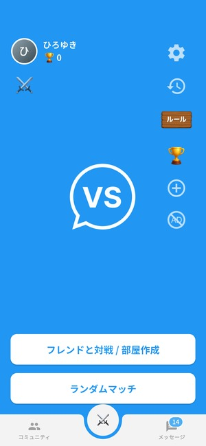 | 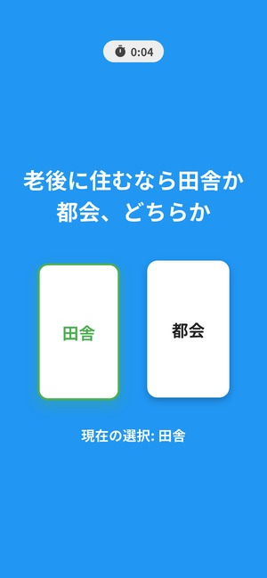 | 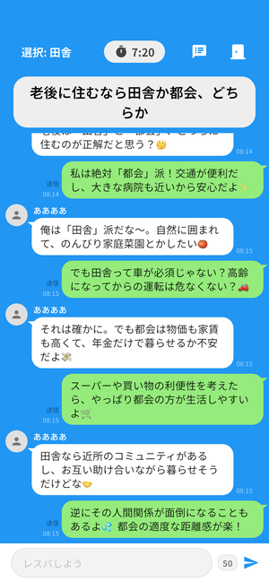 | 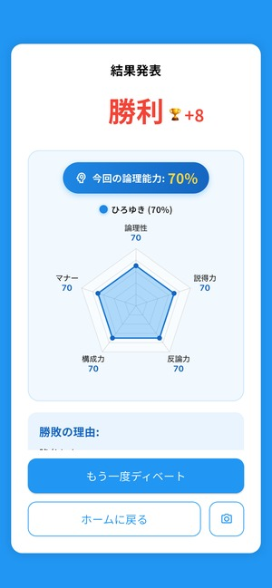 |
| ランダム対戦・合言葉でのフレンド対戦に対応 | 両者が異なる立場を選ぶと10分間の試合が開始 | LINE風UI・リプライ機能・残り時間のリアルタイム同期 | 5項目レーダーチャートと判定理由を表示しレート（トロフィー）が増減 |

<details>
<summary>📸 コミュニティ・SNS機能（対戦募集・掲示板・クラブ）の画面一覧を開く（クリックで展開）</summary>

| 5. 対戦募集タブ | 6. 掲示板（タイムライン）タブ | 7. クラブ（オープンチャット）タブ | 8. ストア紹介モック |
| :---: | :---: | :---: | :---: |
| 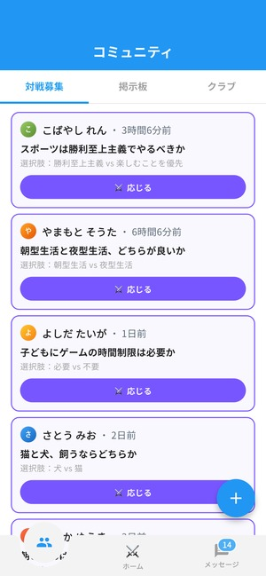 | 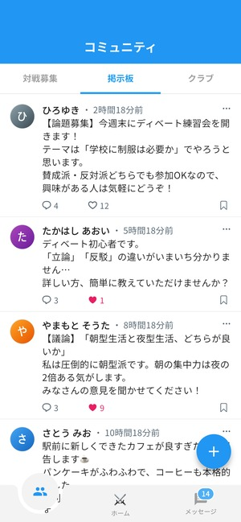 | 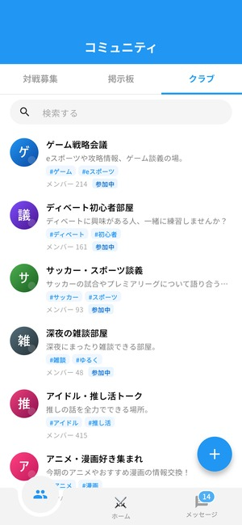 | 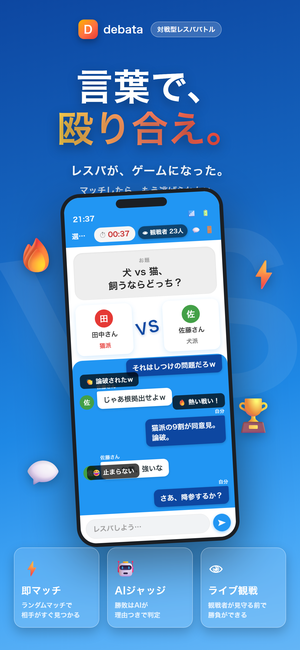 |
| 任意のテーマと立場を設定して対戦相手を募集・応募 | 投稿にお題付きの「対戦募集カード（アプリ内呼称：レスバ）」を添付し、タップで即対戦可能 | 共通の話題で交流・管理人によるメンバー管理や観戦に対応 | ライブ観戦・AIジャッジ・即マッチの全体像 |

</details>

---

## 目次

1. [サービス概要と定量実績](#-1-サービス概要と定量実績)
2. [制作背景・課題意識と仕様への反映](#-2-制作背景課題意識と仕様への反映)
3. [主な機能とスコープ判断（やったこと／やらなかったこと）](#-3-主な機能とスコープ判断やったことやらなかったこと)
4. [技術スタックと選定理由](#-4-技術スタックと選定理由)
5. [システムアーキテクチャ・DB設計・処理フロー](#-5-システムアーキテクチャdb設計処理フロー)
6. [工夫した点・技術的チャレンジ](#-6-工夫した点技術的チャレンジ)
7. [品質保証：テスト・セキュリティ・パフォーマンス](#-7-品質保証テストセキュリティパフォーマンス)
8. [ディレクトリ構成](#-8-ディレクトリ構成)
9. [セットアップ・実行手順・使い方](#-9-セットアップ実行手順使い方)
10. [開発体制・担当範囲・生成AIの活用スタンス](#-10-開発体制担当範囲生成aiの活用スタンス)
11. [今後の改善予定・既知の制約](#-11-今後の改善予定既知の制約)
12. [ライセンス・著者情報](#-12-ライセンス著者情報)

---

## 📊 1. サービス概要と定量実績

「レスバト」は、オンライン上でマッチングした2人のユーザーがテーマに沿ってリアルタイムチャットで議論し、AI審判が内容を採点して勝敗を決める対戦型ディベートアプリです。相手の意見を理解し、尊重しながら議論する力を練習できる場を目指し、論理性や反論力だけでなく**「マナー」を勝敗の評価軸に組み込んだ設計**を特徴としています。

- **基本フロー**：`1. マッチング` ➔ `2. テーマ・立場の決定（両者が異なる選択肢を選択）` ➔ `3. LINE風チャットで対戦（10分間）` ➔ `4. AIによる5項目採点・勝敗判定` ➔ `5. 勝敗に応じたレート（トロフィー）増減・ランキング反映`
- **現在の実装状態**：iOS（App Store）・Android（Google Play）の両ストアにて本番公開・継続運用中。運用データ分析から特定した課題や次期改修計画は「[11. 今後の改善予定・既知の制約](#-11-今後の改善予定既知の制約)」に記載しています。

### 主な実績・規模感（ファクト）

| 指標 | 実績・数値 | 備考（集計時点・データ定義） |
| :--- | :--- | :--- |
| **累計登録者数（主要指標）** | **約2,180人** | 本番DB `users` テーブル集計（2026年8月時点） |
| **累計対戦数** | **約7,000試合** | マッチング待機のみを除き、実際に開始された累計試合数 |
| **ショート動画による集客施策** | **累計約6万再生相当**<br>（約3カ月で登録者 約1,000人 ➔ 約2,000人） | 対戦ログから自動生成した動画約30本をTikTok・YouTube Shortsの2媒体へ計約60投稿（平均約1,000再生×約60投稿の概算。※直接流入計測ではなく投稿期間前後の登録者推移） |
| **ストア獲得数（参考値）** | **iOS 累計約1,830 DL**<br>**Android 約223台（過去6カ月）** | 各ストア管理画面の統計（OS間で集計期間・定義が異なるため参考値） |
| **収益・運用コスト** | **広告収益 年間約2万円（黒字化）** | Google AdMob収益がLLM API費・サーバー運用費を上回り単体黒字化 |
| **AI判定コスト削減** | **1判定あたり概算 約70%削減** | 審判モデルを Gemini API から DeepSeek API（`deepseek-chat`）へ移行した効果 |

---

## 💡 2. 制作背景・課題意識と仕様への反映

### なぜ作ったか（原体験）
SNSのコメント欄で意見の違いが相手への悪口や誹謗中傷に発展する場面や、日常で意見の食い違いから感情的な口論になる場面を多く目にしたことが開発のきっかけです。海外の教育向け議論サービス「[Kialo Edu](https://www.kialo-edu.com/)」のように論点を整理して議論する場の事例を参考にしつつ、初心者でもゲーム感覚で参加でき、**相手の意見を理解・尊重しながら主張と反論を交わす練習ができる場**を作りたいと考えました。

### 課題からプロダクト仕様への落とし込み

| 課題意識・発生した問題 | 既存手段や初期仕様の限界 | 本アプリでの解決策（仕様・設計への反映） |
| :--- | :--- | :--- |
| **オンラインの議論が感情的な罵倒に陥りやすい** | SNSには明確なルールや中立な審判がなく、攻撃的な発言が目立ちやすい | AI審判の採点項目に**「マナー（冷静さ・品格・ルール遵守：100点満点）」**を組み込み、相手への接し方も勝敗に直結する評価ルールを設計（※誹謗中傷の減少効果や議論力の向上度合い自体は未計測） |
| **勝敗判定の根拠が見えないと納得感が出にくい** | 初期（Gemini採用時）は勝敗と理由文のみを表示しており、なぜ負けたかが直感的に伝わりにくかった | DeepSeekへの移行に合わせ、**「論理性・説得力・反論力・構成力・マナー」の5項目別スコア**とレーダーチャート、判定理由文を結果画面で可視化 |
| **2人同時参加が必須なため、閑散時間帯にマッチングが成立しにくい** | リリース後、ストアレビュー等で「マッチングしない」という声が複数寄せられた | ①待機者発生時に既存ユーザーへ知らせる**プッシュ通知（連続通知防止つき）**を実装<br>②1人でアプリを開いた時間にも滞在・交流できる**掲示板・対戦募集・クラブ（SNS機能）**を追加 |
| **個人開発で広告予算がなく、認知を広げにくい** | ストア公開だけでは新規流入が限られ、母数不足がマッチング難にも直結していた | アプリ内の対戦ログを匿名化し、**VOICEVOX（掛け合い音声）× Remotion（チャットUI動画）でショート動画を自動生成**する仕組みを構築してTikTok・YouTube Shortsへ継続投稿 |
| **初期設定の「試合時間3分」では議論が深まらない** | 手軽さを優先して1試合3分にした結果、ストアレビューで「短すぎて主張と反論がしきれない」との声が届いた | ユーザーの声と実際の対戦ログを受け、通常の制限時間を**3分から10分（600秒）へ延長**し、双方が早期に合意した場合は途中でも判定へ進める仕様に改善 |

### ターゲットユーザー
- **想定利用者**：議論系コンテンツを見るのが好きで、自分でもゲーム感覚で主張や反論を楽しみたい学生・社会人（競技ディベート未経験者でも、提示されたお題と2択の立場を選ぶだけで参加可能）。
- **非対象（スコープ外）**：学術論文レベルの厳密なファクトチェック、3人以上での同時討論（※1対1のリアルタイムテキスト対戦に特化）。

---

## ✨ 3. 主な機能とスコープ判断（やったこと／やらなかったこと）

### 実装済み機能一覧

| 分類 | 機能名 | できること・技術的な仕組み | 状態 |
| :--- | :--- | :--- | :---: |
| **コア (P0)** | **リアルタイム対戦＆マッチング** | ランダムマッチ・合言葉でのフレンド対戦に対応。DB行ロックによる排他マッチングと、Supabase Realtime 3機能（状態・在席・観戦）の使い分けによるリアルタイム同期 | 完成 |
| **コア (P0)** | **リプライ構造化＆AI 5項目採点** | チャット内の特定発言へのリプライ関係を `[#番号 (↩ #対象への反論)]` として構造化し、DeepSeek API が5項目（各100点）と理由をJSON出力。結果画面でレーダーチャートを描画 | 完成 |
| **コア (P0)** | **端末非依存の試合終了予約** | 立場決定時に Upstash QStash へ試合終了時刻（10分後）の遅延HTTP実行を予約し、両端末が切断されてもサーバー主導でAI判定を完結 | 完成 |
| **コア (P0)** | **通信切断検知（20秒復帰猶予）** | 対戦中の相手離脱を Realtime `Presence` で検知。一時的な回線瞬断で即敗北にならないよう、アプリ側で20秒のカウントダウン猶予を設けて復帰を待機 | 完成 |
| **運用 (P1)** | **待機通知＆レート制限** | ランダムマッチ待機発生時に FCM で既存ユーザーへプッシュ通知を配信。同一ユーザーの連続通知（荒らし）を防ぐレート制限を実装 | 完成 |
| **運用 (P1)** | **コミュニティ機能（SNS化）・観戦** | 対戦募集・掲示板・クラブ（オープンチャット）・1対1 DM。投稿やチャットにお題付きの「対戦募集カード（レスバ）」を添付してワンタップで対戦開始できる導線と、リアルタイム観戦・コメント配信 | 完成 |
| **安全 (P1)** | **UGC安全対策・機種変更引き継ぎ** | 両OSストア審査基準に準拠した通報・ブロック・特定メッセージ非表示・アカウント削除機能、および引き継ぎコードによる端末間データ移行 | 完成 |
| **収益 (P1)** | **広告配信（AdMob）** | ホーム・コミュニティ画面のバナー広告、およびユーザー体験を損なわないよう**3試合に1回**に頻度を制御した対戦後インタースティシャル広告 | 完成 |
| **集客 (P1)** | **ショート動画自動生成パイプライン** | `room_id` を指定すると、対戦ログ抽出・匿名化・VOICEVOX音声合成・無音トリミング・Remotionレンダリング（1080×1920, 60fps）を経て約10分で完成動画を出力 | 完成 |

### 設計判断（やったこと／あえてやらなかったこと）

| 判断項目 | 採用した選択 | あえてやらなかったこと（見送った選択肢）と理由 |
| :--- | :--- | :--- |
| **試合タイマーの同期方式** | **開始時刻（`updated_at`）＋サーバー時刻オフセットによる端末内算出** | **サーバーで毎秒残り時間を減算してDB更新する方式**：初期に試したものの、10分間の試合で最大600回のDB更新とRealtime配信が発生するため廃止 |
| **試合終了時のAI判定起動** | **DBトリガー＋QStash遅延メッセージ（1試合1回登録）** | **クライアント端末から時間経過後にEdge Functionを呼ぶ方式**：アプリ強制終了やWi-Fi不調時に判定が実行されず試合が宙に浮くリスクを設計段階で排除するため |
| **観戦コメントの配信経路** | **Supabase Realtime `Broadcast`（DB非保存）** | **観戦コメント（ヤジ）をすべてDBへINSERTする方式**：観戦中の盛り上がり演出に永続化は不要であり、DB書き込み負荷とストレージ消費を抑えるため |
| **集客動画の編集範囲** | **実ログの匿名化＋VOICEVOX音声化＋Remotion自動映像化** | **LLMによる発言の要約・誇張・書き換え**：実際のアプリ内でどのような議論が行われているかをありのまま伝えるため、内容の改変は行わず無音区間のカットとSE付与のみを自動化 |

---

## 🛠 4. 技術スタックと選定理由

### 使用技術一覧

| カテゴリ | 技術（バージョン） | 本プロダクトでの役割・用途 |
| :--- | :--- | :--- |
| **フロントエンド** | Flutter 3.x / Dart (`^3.10.0`) | iOS・Android両対応UI、MVVM構成、画面遷移（`go_router`） |
| **状態管理・モデル** | `hooks_riverpod` (`^2.6.1`) / `flutter_hooks` (`^0.21.3`) / `freezed` (`^4.0.0`) | ルーム状態・Realtime購読ライフサイクル管理、イミュータブルモデル定義 |
| **バックエンド / BaaS** | Supabase（Auth / PostgreSQL / Storage / Edge Functions） | 匿名認証、データ永続化、画像ストレージ、Deno (TypeScript) によるサーバーレス関数 |
| **リアルタイム / 非同期** | Supabase Realtime / Upstash QStash / `pg_net` | `Postgres Changes`（状態同期）、`Presence`（在席・観戦者数）、`Broadcast`（観戦コメント）、QStash（10分後のAI判定予約実行） |
| **AI / 外部API** | DeepSeek API (`deepseek-chat`) ※初期は Gemini API | ディベート内容の5項目採点（0〜100点）・判定理由のJSON生成 |
| **通知・収益化** | Firebase Cloud Messaging (`^16.1.2`) / Google Mobile Ads (`^9.1.0`) / RevenueCat (`^10.9.1`) | 待機通知・DM/募集通知配信、バナー・全画面広告による収益化 |
| **動画生成（集客）** | Remotion (React / TypeScript) / Python / VOICEVOX | 対戦ログからの縦型ショート動画（1080×1920, 60fps）自動合成パイプライン |
| **CI/CD・配信** | Codemagic / Shorebird | Windows開発環境からクラウドMacを用いたiOSビルド・App Store Connect配信 |

### 技術選定の理由とトレードオフ（面接での説明軸）

| 技術領域 | 採用した技術 | 比較・検討した代替候補 | 採用理由（要件・制約・トレードオフの決定打） |
| :--- | :--- | :--- | :--- |
| **モバイルFW** | **Flutter** | React Native / Swift・Kotlin個別開発 | 個人でiOS・Androidの両方へ効率よく公開・保守するためクロスプラットフォームを前提に検討。同じWidget構成で両OSのUIを揃えやすく、レーダーチャートやトロフィー演出などのアニメーションをイメージ通りに実装しやすい点、公式資料の充実度から選定 |
| **BaaS / DB** | **Supabase (PostgreSQL)** | Firebase (Firestore) / AWS自前構築 | 個人開発でインフラ構築よりサービス公開と検証速度を優先しBaaSを選択。Firebaseと比較し、PostgreSQLの関数・トリガー（選択肢一致時の再抽選や勝敗確定時の処理）と、`Presence`・`Broadcast`・`Postgres Changes` の3種のRealtime機能を同じ基盤で一貫して扱える点を重視 |
| **非同期予約実行** | **Upstash QStash** | 定期Cron実行 / クライアント側タイマー起動 | 定期実行のCronではなく「各試合の開始から10分後に1回だけEdge Functionを叩く」という試合単位の遅延メッセージングが要件に合致し、どちらのユーザー端末にも依存せずサーバー側で判定を開始できるため採用 |
| **AI審判モデル** | **DeepSeek API** | Gemini API（初期採用） / OpenAI API | 初期はGeminiで勝敗と理由のみを取得していたが、黒字運用と納得感向上を目指しLM Arenaの評価およびAPI料金を比較。コストと日本語性能のバランスに優れたDeepSeekへ移行し、5項目採点へ拡張しつつ1回あたりのAI利用コストを概算約70%削減 |

---

## 🏗 5. システムアーキテクチャ・DB設計・処理フロー

### 1. システム全体構成図

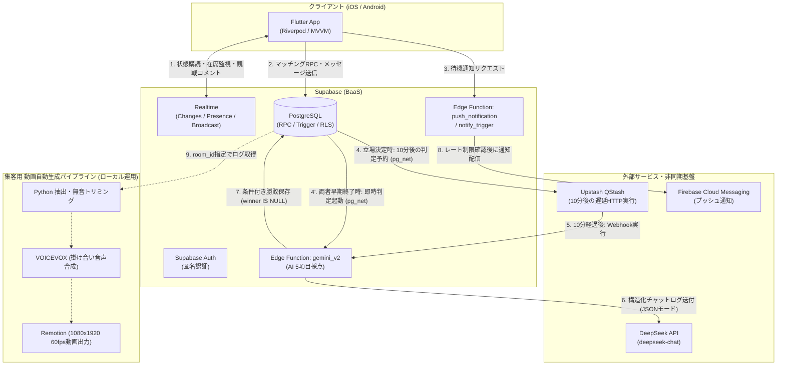

**アーキテクチャ設計のポイント**：
- **クライアント非依存の進行管理**：AI判定の起動をユーザー端末に任せず、DBトリガーから QStash へ遅延実行を登録することで、試合中に両者が通信切断やアプリ終了してもサーバー側で試合が完結します。
- **Realtime 3機能の責務分離**：DB永続化が必要なルーム状態・チャットは `Postgres Changes`、オンライン生存確認と観戦者カウントは `Presence`、永続化不要な観戦コメント（ヤジ）は `Broadcast` に分けることで、不要なDB書き込みを排除しています。
- **秘匿情報と状態遷移のサーバー集約**：LLMのAPIキーや採点プロンプトは Edge Functions 側に隠蔽し、テーマ抽選や勝敗確定時の状態保護は PostgreSQL の RPC・トリガー層に集約しています。

### 2. データベース設計（ER図）と整合性担保

<details>
<summary>📊 主要テーブルのER図を開く（クリックで展開）</summary>

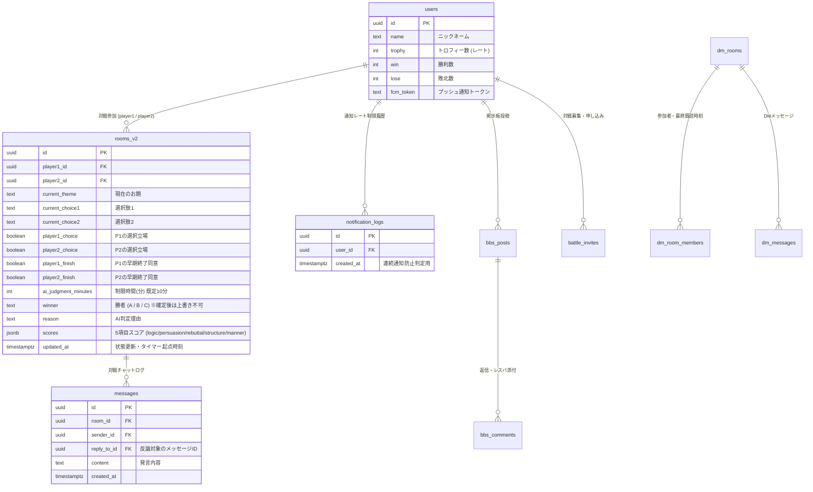

</details>

**データ整合性・排他制御の工夫**：
- **マッチング時の行ロック（`FOR UPDATE SKIP LOCKED`）**：待機中ルームを検索する際、`LIMIT 1 FOR UPDATE SKIP LOCKED` を使用し、複数ユーザーが同時にマッチングボタンを押した際のルーム重複割り当てを防いでいます。
- **勝敗確定の冪等性（二重更新防止）**：制限時間満了と早期終了合意が競合しても結果が上書きされないよう、条件付きUPDATE（`winner IS NULL`）とDBトリガーによる確定済みカラム保護で冪等性を担保しています（詳細は「[6. 工夫した点・技術的チャレンジ](#-6-工夫した点技術的チャレンジ)」の2項目目に記載）。
- **同じ選択肢を選んだ際の自動再抽選トリガー**：両プレイヤーが同じ立場を選んだ場合は試合を開始せず、DBトリガー内で既出テーマ（`used_theme_ids`）を除外して新しいお題を自動抽選し、異なる立場に分かれた時点で初めて試合開始・QStash予約が走る状態遷移をDB層に集約しています。

### 3. 対戦開始〜AI判定〜結果反映の処理フロー（シーケンス図）

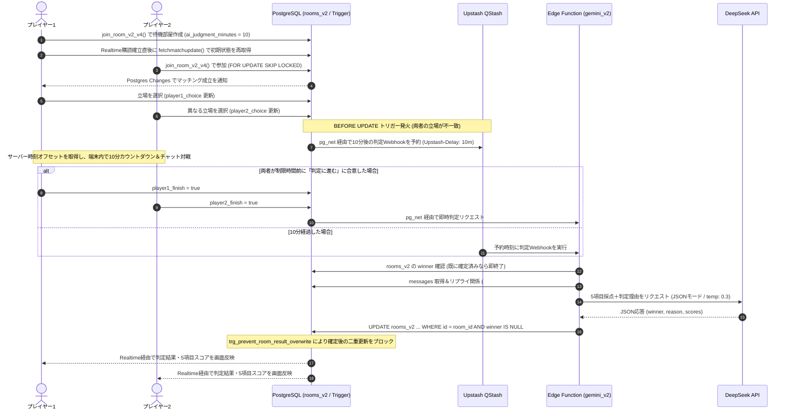

---

## 🔥 6. 工夫した点・技術的チャレンジ

> 開発・運用の中で実際に直面した技術的・プロダクト的課題と、その解決プロセスです。

### 1. [通信量・DB負荷の最適化] 毎秒DBを更新するタイマーを廃止し、サーバー時刻オフセットによるローカル算出へ刷新
- **問題**：初期実装では試合の残り時間を2人の端末間で同期するため、サーバー側で毎秒残り時間を減算してDBを更新し、フロントエンドがそれを監視する構成にしていました。しかし、試合時間を10分（600秒）にすると1試合だけで最大600回のDB更新とRealtime配信が発生し、負荷と通信量が肥大化する問題がありました。
- **原因・切り分け**：刻々と変わる「残り秒数」そのものをDBで共有しようとしていたことが原因でした。必要なのは「いつ試合が始まり、いつ終わるか」という基準時刻の共有のみでした。
- **対応**：DBには状態更新時刻（`updated_at`）のみを保持し、試合開始時に `get_server_time` RPCで取得したサーバー時刻と端末時計の差（`timeOffset = serverTime.difference(clientTime)`）を一度だけ算出する方式（`lib/views/GamePage.dart`）へ変更しました。以降は各端末内で `deadline` との差分を毎秒計算し、さらに `ValueNotifier<int?>` でタイマー表示Widgetのみを局所更新することで、毎秒の画面全体リビルドも防ぎました。
- **結果・検証**：タイマー表示に伴う毎秒のDB更新・Realtime配信をゼロに削減し、端末の時計がズレている環境でも2台の実機間で終了カウントダウンが正確に一致することを確認しました。

### 2. [非同期処理・耐障害性] 端末非依存のAI判定予約（QStash）と3段階の二重判定防止
- **問題**：制限時間終了後のAI判定リクエストをどちらかのプレイヤー端末から送信する設計にすると、試合中にアプリを閉じた場合や通信切断・Wi-Fi不調が起きた際に判定処理が呼ばれず、試合が終了しなくなるリスクがありました。また、制限時間による自動判定と、両者が早く議論を終えた際の即時判定が重なると、AI判定が二重に走る課題がありました。
- **原因・切り分け**：公開前の設計・検証段階で「ゲームの進行確定をクライアント端末の生存に依存させている点」と「複数の判定起動経路が競合する点」を切り分けました。
- **対応**：
  1. **QStashによる遅延実行**：両者が異なる立場を選択して試合が始まった瞬間に、PostgreSQLのトリガー（`handle_room_updates_v2`）から Upstash QStash へ10分後の遅延HTTPリクエスト（`Upstash-Delay: 10m`）を1回だけ予約登録し、サーバー主導で `gemini_v2` Edge Function を起動する構成にしました。
  2. **二重判定の防止**：Edge Function 冒頭での `winner` 存在チェック、UPDATE時の `.is("winner", null)` 条件、さらにDB側の `BEFORE UPDATE` トリガー（`trg_prevent_room_result_overwrite`）を組み合わせ、後から到着した判定リクエストが結果を上書きできない冪等な設計にしました。
- **結果・検証**：対戦開始後に両端末のアプリを落としても10分後にサーバー側でAI判定が完了して結果が記録されること、および早期終了と予約実行が重なっても二重更新が起きないことを確認しました。

### 3. [並行処理・競合状態対策] マッチング直後のRealtimeイベント取りこぼし（Race Condition）の解消とPresence監視
- **問題**：実機2台とエミュレーターを用いた同時マッチング検証中、先に入ったプレイヤー1がルームを作成して Realtime 購読（`onPostgresChanges`）を開始するまでのわずかな隙間にプレイヤー2が参加すると、プレイヤー2はRPCの返り値から対戦画面へ遷移できる一方、プレイヤー1は更新イベントを取り逃して待機画面に残り続ける競合状態（Race Condition）が発生しました。
- **原因・切り分け**：DBへの `INSERT` 完了から WebSocket チャンネルの `RealtimeSubscribeStatus.subscribed` 確立までの数十〜数百ミリ秒の間に起きた `UPDATE` イベントは、購読開始前のためクライアントに配信されないことが原因でした。
- **対応**：
  1. **購読確立直後の再フェッチ**：`waitForMatch`（`lib/provider/matching_provider.dart`）において、ステータスが `subscribed` になった直後に必ず `fetchmatchupdate()` で最新のルーム状態を1回DBから取得し、購読完了前の変更を確実に拾う処理を追加しました。
  2. **Presenceによる切断検知とSDK不具合の回避**：対戦中の通信切断検知には Realtime `Presence` を採用し、一時的な回線瞬断で即座に負けにならないようアプリ側で20秒の復帰待ちタイマー（`_startOfflineTimer`）を実装しました。また、`supabase_flutter` の高レベルAPI（`onPresenceSync` 等）が本番環境で発火しない事象に遭遇した際、GitHub Issue (#43561) を調査して Phoenix チャネルの内部イベント（`presence_state` / `presence_diff`）を直接リッスンする実装で解決しました。
- **結果・検証**：実機2台＋エミュレーターの計3端末から同時にマッチングを行う並行テストを繰り返し実施し、待機画面への取り残しや意図しない切断負けが発生しないことを確認しました。

### 4. [AI審判の改善・コスト削減] GeminiからDeepSeekへの移行と「マナー」を含む5項目採点・リプライ構造化
- **問題**：初期は Gemini API で「勝者」と「理由文」のみを取得していましたが、①なぜその勝敗になったかの納得感が得にくい、②まれに判定文の内容と勝者ラベルが入れ替わる、③試合数増加に伴うAPIコストを抑えたい、という課題がありました。
- **対応**：LM Arena のリーダーボード評価と API 単価を比較して DeepSeek API（`deepseek-chat`）へ移行しました。その際、単なるテキスト羅列ではなくチャットのリプライ関係（`[#3 (↩ #1への反論/応答)]`）を木構造としてプロンプトに整形する処理を組み込み、「論理性・説得力・反論力・構成力・マナー」の5項目（各100点満点）を採点してレーダーチャートで表示する形式へ刷新しました。
- **結果・検証**：1回あたりのAI判定コストを概算約70%削減しつつ、どの発言がどの主張への反論かを踏まえた採点が可能になり、勝者と判定内容の入れ替わりも解消されました。

### 5. [公開後のグロース・運用改善] 2人同時参加の壁に対する「待機通知 × SNS化 × 動画自動生成」でのアプローチ
- **問題**：公開後、①2人が同じ瞬間に参加しないとマッチングが成立しないため、利用者が少ない時間帯に「マッチングしない」という声が届いたこと、②個人開発で広告費をかけられず認知度が低いことの2つが大きな壁となりました。また、初期の「試合時間3分」に対して「短すぎる」というレビューが多く寄せられました。
- **対応**：
  1. **プロダクト改善（試合時間延長・待機通知・SNS化）**：レビューを受けて試合時間を3分から10分へ延長。さらに、誰かがランダムマッチを開始した際に通知許可ユーザーへ知らせる待機通知（同一ユーザーの連続通知を防ぐレート制限つき）を実装しました。加えて、ユーザーが対戦チャットを雑談にも使っている行動に着目し、対戦相手がいない時間にも滞在・交流できる掲示板・対戦募集・クラブ・DM機能（チャット内から直接対戦を送れる導線つき）を追加しました。
  2. **集客用ショート動画の自動生成**：アプリ内で生まれる対戦ログに着目し、`room_id` を渡すと発言の匿名化、VOICEVOXによる2人の掛け合い音声生成、無音区間（-40dB以下）のミリ秒単位カット、RemotionによるチャットUI＆結果画面の動画レンダリングまでを約10分で自動完結するパイプラインを構築し、TikTok・YouTube Shorts へ約3カ月間（週3回ペース）継続投稿しました。
- **結果・検証**：待機通知後に実際にユーザーが参加する挙動を実機で確認し、SNS機能でもユーザー間の投稿・交流が生まれました。ショート動画は約30本（2媒体合計約60投稿）で累計約6万再生相当となり、投稿を行った約3カ月で登録者数は約1,000人から約2,000人へ増加（現在累計約2,180人・約7,000試合、広告収益で年間約2万円の黒字化を達成）。

---

## 🛡 7. 品質保証：テスト・セキュリティ・パフォーマンス

### テスト・検証方針とカバー範囲

| 対象領域 | 検証内容・手法 | 状態 |
| :--- | :--- | :---: |
| **並行処理・実機結合検証** | 実機2台＋エミュレーターを用い、3端末同時マッチング、回線切断（機内モード切替→20秒以内の復帰／タイムアウト）、早期終了とタイマー満了の競合を手動・実機検証 | 実施済み |
| **DBクエリ・RLS静的レビュー** | マイグレーションSQL（RLSポリシー、SECURITY DEFINER関数の権限境界、未読管理のN+1解消、インデックス設計）の監査と修正反映（詳細は [`html/データベースレポート.md`](./html/データベースレポート.md)） | 実施済み |
| **本番対戦ログの定量分析** | `match_record` 2,316件の稼働データから時間帯別ピーク、AI判定成功率（91.53%）、エラー発生傾向（8.47%）を集計・原因切り分け（詳細は [`docs/分析.md`](./docs/分析.md)） | 実施済み |
| **自動単体テスト / E2Eテスト** | 画面UIおよびリアルタイム通信の確認は実機検証を中心としており、Edge Functionsの単体テストおよびAI採点の一貫性評価スクリプトは次期改修（[`docs/AI判定_修正指示書.md`](./docs/AI判定_修正指示書.md)）にて導入予定 | 計画中 |

### セキュリティ・プライバシー・パフォーマンス対策
- [x] **機密情報の分離**：`.env` や Firebase サービスアカウント鍵（`service-account.json`）、署名キー（`key.jks`）は `.gitignore` で除外し、DeepSeek API キーは Supabase Edge Functions の環境変数側で管理。
- [x] **認可と関数ガード**：Supabase RLS（Row Level Security）を有効化し、`mark_dm_room_read` 等の `SECURITY DEFINER` 関数にはメンバーシップ検証（`is_dm_room_member`）と `SET search_path = public` を適用。
- [x] **UGC安全対策（ストアガイドライン準拠）**：不適切投稿やユーザーの通報・ブロック・メッセージ非表示・退会（アカウント削除）機能を完備し、ブロック相手からのプッシュ通知もDBトリガーおよびEdge Function層で遮断。ショート動画化時はユーザー名を完全匿名化。
- [x] **クエリ・描画パフォーマンス最適化**：
  - DM・クラブ受信箱の未読数取得をメッセージ単位の `is_read` 更新からメンバー単位の `last_read_at` 方式＋一括取得RPC（`get_dm_inbox` / `get_open_chat_inbox`）へ変更し、ルーム数×4回発生していた N+1 クエリを1クエリに削減。
  - `notify_trigger` Edge Function で Google OAuth アクセストークンをモジュールスコープにキャッシュし、ウォームスタンバイ中のトークン再取得オーバーヘッドを削減。

---

## 📁 8. ディレクトリ構成

```text
.
├── README.md
├── pubspec.yaml                   # Flutter パッケージ・アセット定義 (version 2.0.0+84)
├── .env.example                   # 環境変数テンプレート（ダミー値）
├── lib/                           # Flutter フロントエンド (MVVM + Riverpod)
│   ├── main.dart                  # エントリポイント（Firebase / Supabase 初期化）
│   ├── modes/                     # データモデル定義 (Freezed: Users, MatchingRoom, DebateScores 等)
│   ├── provider/                  # 状態管理・通信制御 (matching, chat_inbox, notification, resba 等)
│   ├── view_model/                # 画面ロジック・課金管理・NGワード検証
│   ├── views/                     # 画面UI (HomePage, GamePage, FinishPage, bbs/, open_chat/, dm/)
│   ├── widgets/                   # 共通UIコンポーネント (RadarChart, ResbaCard, SpectatorOverlay 等)
│   ├── adsence/                   # Google AdMob 広告制御・同意管理
│   ├── router/                    # GoRouter ルーティング定義
│   └── utils/                     # トロフィー算出ロジック・日時フォーマット等
├── supabase/                      # バックエンド・DB定義
│   ├── functions/
│   │   ├── gemini_v2/             # AI審判 Edge Function (DeepSeek API 5項目採点・勝敗記録)
│   │   ├── push_notification/     # ランダムマッチ待機通知 & 連続通知防止レート制限
│   │   └── notify_trigger/        # DM・掲示板・レスバ応募のプッシュ通知配信
│   └── migrations/                # PostgreSQL スキーマ・RPC・トリガー・RLS マイグレーション群
├── screenshot/                    # アプリ画面スクリーンショット・ストア紹介画像
├── store-screenshots/             # Next.js 製 ストアスクリーンショット生成ツール
├── html/
│   └── データベースレポート.md      # DB設計・RLS・N+1クエリ解消のレビューおよび反映記録
└── docs/
    ├── images/                    # README表示用スクリーンショット（軽量化・ASCII命名済み）
    ├── 分析.md                     # 本番対戦ログ (2,316件) の稼働・AI判定成功率分析レポート
    ├── AI判定_修正指示書.md         # AI判定の堅牢化・スキーマ検証・権限強化の次期改修設計書
    ├── 動画.md                     # VOICEVOX × Remotion ショート動画自動生成パイプライン仕様書
    └── store/                     # App Store / Google Play 公開用説明文・リリースノート
```

---

## 🚀 9. セットアップ・実行手順・使い方

> **最終動作確認**：2026年10月 ／ **確認環境**：Windows 11, Flutter 3.x (Dart `^3.10.0`), Supabase CLI, Android 実機・エミュレーター / iOS (Codemagic)

### 必要条件（Prerequisites）
- Flutter SDK（Dart SDK `^3.10.0` 対応バージョン）
- Supabase CLI / Docker Desktop（ローカルでDB・Edge Functionsを起動する場合）
- Android Studio または Xcode（実機・エミュレーター実行用）

### ローカル起動手順

```bash
# 1. リポジトリのクローン
git clone https://github.com/kazuki-N5/debate_app.git
cd debate_app

# 2. 環境変数の設定（.env.example をコピーして接続先を設定）
cp .env.example .env

# 3. 依存パッケージのインストール
flutter pub get

# 4. （任意）ローカル Supabase & Edge Functions を起動する場合
npx supabase start
npx supabase functions serve

# 5. アプリの起動
flutter run
```

<details>
<summary>💡 動作確認の操作手順・トラブルシュートを開く（クリックで展開）</summary>

#### 主要フローの確認手順
1. **初回起動（匿名ログイン）**：アプリを起動すると自動で匿名セッションが生成されます。利用規約を確認し、ニックネームを入力してホーム画面へ進みます。
2. **対戦の確認**：「ランダムマッチ」または「フレンドと対戦 / 部屋作成（合言葉設定）」からマッチングを開始します。2端末で異なる選択肢を選ぶと10分間のチャット対戦が始まります。
3. **コミュニティ・観戦の確認**：下部ナビゲーションの「コミュニティ」タブから、対戦募集への応募、掲示板への投稿、クラブ（オープンチャット）への参加、および進行中バトルのリアルタイム観戦を確認できます。

#### よくあるつまずき（トラブルシュート）
| 症状 | 確認・対処方法 |
| :--- | :--- |
| 起動時に `.env` 読み込みエラーが出る | `cp .env.example .env` を実行し、`P_VAR_URL` と `P_VAR_ANONKEY` が設定されているか確認してください |
| 実機からローカル Supabase に繋がらない | PCのファイアウォールでポート `54321` が許可されているか、同一Wi-Fiサブネット上にいるか確認してください |

</details>

---

## 🤝 10. 開発体制・担当範囲・生成AIの活用スタンス

### 担当範囲（個人開発）
企画、要件定義、UI/UX設計、Flutterによるフロントエンド実装、Supabase（PostgreSQL / Realtime / Edge Functions）によるバックエンド実装、複数端末での並行テスト、iOS（Codemagic）・Android（12人×14日間のクローズドテスト要件達成を含む）両ストアへの公開、VOICEVOX×Remotionによる集客動画の自動生成・投稿、問い合わせ・通報対応、AdMobによる収益化まで、**すべて一人で一貫して担当**しました。

### 開発における生成AIの活用スタンス
> 基礎は書籍や動画教材のサンプルコードを写経しながら独学で習得し、実装時はチャット型AIを壁打ち相手として活用しました。**AIの出力をそのまま鵜呑みにせず、アーキテクチャ設計・採否判断・エッジケースの切り分け・実機での並行検証はすべて自分自身で行っています。**

| 開発工程 | 生成AIの活用内容 | 自分自身で行った判断・設計・検証 |
| :--- | :--- | :--- |
| **設計・技術選定** | フォルダ構成案や実装方針の壁打ち、公式ドキュメントの要点確認 | 毎秒DB更新タイマーの廃止と時刻オフセット計算への変更、QStashを用いた端末非依存の判定予約設計、Realtime 3機能の責務分離 |
| **実装・統合** | UIコンポーネントの雛形や定型的なクエリコードのたたき台生成 | マッチング時の競合状態（Race Condition）を防ぐ購読直後の再取得処理、二重判定防止トリガー、N+1クエリを解消する一括取得RPCへの書き直し |
| **デバッグ・環境構築** | エラーメッセージの解読補助、原因仮説の洗い出し | AIで解決できなかった `supabase_flutter` の Presence 未発火問題（GitHub Issue #43561）や、Codemagic での iOS ビルド時の CocoaPods 依存関係エラーを公式 Issue 等から特定・解決。実機2台＋エミュレーターでの同時実行テスト |

---

## 🗺 11. 今後の改善予定・既知の制約

本番運用データの集計（[`docs/分析.md`](./docs/分析.md)）とコード監査（[`docs/AI判定_修正指示書.md`](./docs/AI判定_修正指示書.md)）から特定した現在の制約と、今後の改善ロードマップです。

### 今後の改善ロードマップ（Future Work）
- [ ] **AI判定パイプラインの堅牢化と責務分離（設計完了・[`docs/AI判定_修正指示書.md`](./docs/AI判定_修正指示書.md)）**：
  - 本番ログ2,316件の分析で判明したAI呼び出しエラー（8.47%：タイムアウトやJSONパース失敗等）を解消するため、①5項目スコアに基づく勝敗決定を「LLM側のJSON出力」から「サーバーコード側での合計点算出」へ完全分離、②Zodによるスキーマ検証と `max_tokens` / `AbortController` タイムアウト設定、③一時障害時に `winner='C'`（引き分け）を書かずQStashの自動リトライを効かせる `judge_status` カラム分離、④`Upstash-Signature` 署名検証とプロンプトインジェクション対策（`<debate_log>` タグ分離・エスケープ）、⑤匿名化ログ30件を用いた判定一貫性・先攻後攻バイアス評価スクリプトの導入を順次反映予定。
- [ ] **コールドスタート（1人利用時）の導線強化**：
  - 対人マッチング待機中や夜間でも1人で即座に議論の練習ができるAI対戦モードの検討。
- [ ] **音声通話ディベートモードへの拡張**：
  - テキストチャットだけでなく、実際のディベートに近いリアルタイム音声通話での対戦機能の検討。
- [ ] **効果測定基盤の精緻化**：
  - ショート動画からの流入経路計測（キャンペーンリンク）や、待機通知・SNS機能導入前後のマッチング成立時間・7日継続率を定量比較できる計測の整備。

### 既知の制約（Known Limitations）
- **効果測定の範囲**：ショート動画投稿期間（約3カ月）に登録者が約1,000人から約2,000人へ増加したものの、直接流入を識別するパラメータ計測ではないため、動画単体の因果関係は断定していません。同様に、待機通知による待ち時間短縮やSNS化による継続率変化も実機での定性確認にとどまり、前後比較の定量計測は今後の課題です。
- **現行AI判定関数の制約**：現行の `gemini_v2/index.ts` ではAI APIエラー発生時に catch ブロックで `winner='C'`（引き分け扱い）を記録する実装となっているため、正常な引き分けとシステムエラーが画面上で区別しにくい制約があります（上記ロードマップ第1項にて改修設計済み）。

---

## 👤 12. ライセンス・著者情報

- **利用素材・クレジット**：
  - 集客ショート動画 音声合成：VOICEVOX（青山龍星・ずんだもん 等）
- **アプリ利用規約・プライバシーポリシー**：
  - [利用規約](https://humorous-abacus-317.notion.site/22c969f0105080c8997dd39de4574d51?pvs=143) ／ [プライバシーポリシー](https://humorous-abacus-317.notion.site/22c969f01050804097efe13b39f04faa?pvs=143)

### 著者（Author）
**西村 和希（Kazuki Nishimura）**  
中央大学 理工学部 電気電子情報通信工学科（2028年3月卒業予定）

- **GitHub**: [@kazuki-N5](https://github.com/kazuki-N5)
- **連絡先**: `kazuki.nishimura2028@gmail.com` ／ アプリサポート：`kgg5app@gmail.com`
